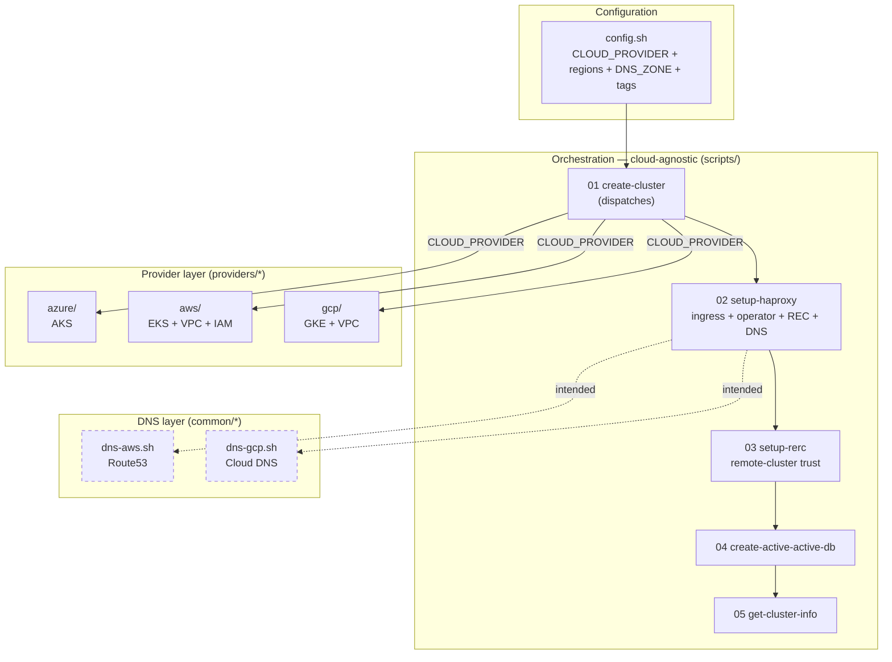
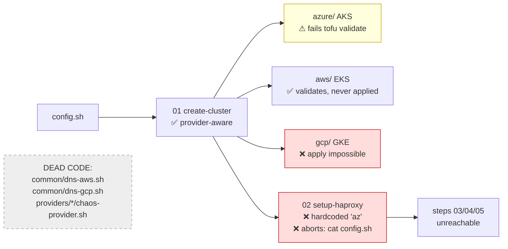
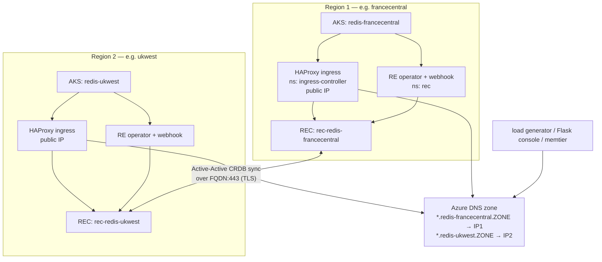

# Architecture Overview

Verified against code on **2026-09-04**, branch `aws_gcp_support` @ `3e7b638`.
Re-grounded from `MULTI_CLOUD_SUPPORT_PLAN.md` / `PHASE*_COMPLETE.md`; where those disagreed
with the code, the code wins. Discrepancies are called out inline as **⚠ CLAIM vs CODE**.

Companion docs: `../product/PRD.md` · `../specs/` · `../adr/` · `../TODO.md` ·
`../migration-status.md` · human guide `../../README.md`

---

## 1. Intended design

Three layers, with the cloud-specific parts isolated behind a thin dispatch seam:



Dashed = designed but **never wired up**.

## 2. What is actually implemented



The abstraction seam exists at **step 01 only**. Steps 02–05 — which do the Redis Enterprise
work — never learned about `CLOUD_PROVIDER`.

## 3. Runtime topology (Azure, the working path)



**Why DNS is mandatory:** Redis Enterprise Active-Active identifies participating clusters by
**FQDN**, not IP. Each cluster therefore needs a resolvable wildcard record
`*.<cluster>.<DNS_ZONE>` pointing at its ingress LoadBalancer IP, so that
`<db>-db.<cluster>.<zone>` and `api.<cluster>.<zone>` resolve. This is the single hardest
prerequisite and the reason a real, owned DNS zone is required.

## 4. Deployment sequence

```mermaid
sequenceDiagram
    participant U as Operator (host)
    participant S as scripts/
    participant TF as tofu
    participant K as kubectl/helm
    participant D as Cloud DNS

    U->>S: ./create-all.sh
    S->>TF: 01 — cd providers/$CLOUD_PROVIDER; init; apply
    TF-->>S: 2 K8s clusters
    S->>K: 01 — get-credentials.sh (kubeconfig contexts)
    loop each cluster
        S->>K: 02 — helm install haproxy-ingress 0.14.4
        S->>K: 02 — apply RE operator bundle.yaml (from GitHub master ⚠ unpinned)
        S->>K: 02 — wait admission-tls secret, wait REC CRD
        S->>K: 02 — sed templates/rec.yaml -> apply REC
        S->>K: 02 — wait ingress public IP
        S->>D: 02 — upsert *.<cluster> A record
        S->>K: 02 — apply admission webhook (with cert)
    end
    S->>K: 02 — wait both RECs state == Running
    loop each cluster
        S->>K: 03 — read rec-<cluster> secret (user/pass)
        S->>K: 03 — apply RERC secrets + RERC objects for BOTH clusters
    end
    S->>K: 03 — PATCH /v1/settings/ui (session timeout 86400)
    S->>K: 04 — sed templates/re-aa-db.yaml -> apply REAADB
    S->>K: 05 — print URLs, credentials, connection strings
```

## 5. Component reference

### 5.1 Configuration — `config.sh`

Single source of truth. Declares `AZURE_*`, `AWS_*`, `GCP_*` blocks, then a `case
$CLOUD_PROVIDER` maps the selected one onto generic names:

| Generic | Azure | AWS | GCP |
|---|---|---|---|
| `CLUSTER_RESOURCE_GROUP` | `AZURE_CLUSTER_RESOURCE_GROUP` | `AWS_CLUSTER_RESOURCE_GROUP` (a tag) | `GCP_PROJECT_ID` |
| `DNS_RESOURCE_GROUP` | `AZURE_DNS_RESOURCE_GROUP` | **unset** | **unset** |
| `REGION1` / `REGION2` | `AZURE_REGION*` | `AWS_REGION*` | `GCP_REGION*` |
| `INSTANCE_TYPE` | `AZURE_INSTANCE_TYPE` | `AWS_INSTANCE_TYPE` | `GCP_INSTANCE_TYPE` |

Derived: `CLUSTER1=${CLUSTER_PREFIX}-${REGION1}`, `CLUSTER2=…${REGION2}`, `NS=rec`,
`AA_DB_NAME=active-active-db`, `DNS_ZONE`, `owner`, `skip_deletion`. `CLUSTER3` is declared
empty and is **not** used by the deployment pipeline, but *is* read by the test tooling
(`redis-enterprise-testing/launch_test.sh`, `redis_connectivity_benchmark.py`) — so 3-way
Active-Active is anticipated on the client side only. An invalid `CLOUD_PROVIDER` calls `exit 1`.

> **⚠ CLAIM vs CODE — `config.sh` is only partly honoured.** `scripts/01-create-cluster.sh`
> exports only `TF_VAR_owner`, `TF_VAR_skip_deletion` (+ Azure's `subscription_id`, `azure_rg`).
> **`REGION1`/`REGION2`/`INSTANCE_TYPE` are never exported as `TF_VAR_*`**, so Terraform falls
> back to the defaults in `providers/*/variables.tf`. Azure works only because those defaults
> coincide. AWS/GCP disagree (`GCP_REGION2=europe-west1` vs default `us-west1`;
> `AWS_INSTANCE_TYPE=m5.2xlarge` vs default `t3.xlarge`; `GCP_INSTANCE_TYPE=n1-standard-8` vs
> default `e2-standard-4`). Step 01 also exports `TF_VAR_aws_account_id`, which **no AWS
> variable declares**.

### 5.2 Provider layer — `providers/<cloud>/`

Contract per provider: `main.tf`, `variables.tf`, `outputs.tf`, `get-credentials.sh`,
`chaos-provider.sh`. Step 01 `cd`s into the selected directory and runs `tofu init && tofu
apply -auto-approve`, then `./get-credentials.sh`.

| | Azure | AWS | GCP |
|---|---|---|---|
| `main.tf` lines | 69 | 395 | 327 |
| Provider pin | **none** ⚠ | `aws ~> 5.0` | `google ~> 5.0` |
| `tofu validate` | **FAILS** | passes | passes |
| Clusters | 2× `azurerm_kubernetes_cluster` in 1 resource group | 2× `aws_eks_cluster` + node groups | 2× `google_container_cluster` + node pools |
| Network | `kubenet`, default | 2× VPC, public+private subnet per region, IGW, route tables | 1 global VPC, subnet per region, 2 firewall rules (internal, redis) |
| IAM | SystemAssigned identity | 2 roles + 5 policy attachments | default SA |
| Nodes | fixed 3 | autoscaling 2–5, desired 3 | autoscaling 2–5, 3/zone |
| Tag mechanism | per-resource `tags` | provider `default_tags` | provider `default_labels` |
| `owner` format validated | no | yes (regex) | yes (regex) |

- **Azure fails validation** because `providers/azure/{main,variables}.tf` are **byte-identical
  copies** of the legacy root files with no `terraform{}` block; azurerm resolves to 5.4.0,
  which requires a `node_provisioning_profile` block. The legacy root path survives only via
  its committed `.terraform.lock.hcl` pinning azurerm **4.26.0**.
- **GCP cannot apply**: `project_id` has no default and step 01 never exports
  `TF_VAR_project_id` (it only runs `gcloud config set project`) → *"No value for required
  variable"*.
- AWS/GCP pins (`~> 5.0`) are themselves behind current majors — confirm via Context7 before bumping.

### 5.3 Orchestration — `scripts/`

| Script | Provider-aware? | State |
|---|---|---|
| `01-create-cluster.sh` | **yes** (`case`, 3 arms) | works in principle; variable wiring incomplete |
| `02-setup-haproxy.sh` | **no** — 4 hardcoded `az` calls | **aborts on line 39** (`cat config.sh` + `set -e`) |
| `03-setup-rerc.sh` | n/a (pure kubectl) | same `cat config.sh` bug, no `set -e`; broken `templates/` paths |
| `04-create-active-active-db.sh` | n/a | broken paths; hardcodes `-n rec` instead of `$NS` |
| `05-get-cluster-info.sh` | n/a | hardcodes `-n rec`; `SC2207` array split |
| `create-all.sh` | passes through | orchestrates 01→04, times each, then 05 |
| `delete-all-resources.sh` | **yes** (4 refs) | provider-aware teardown |
| `chaos.sh` | **no** — 9 hardcoded `az` calls | Azure only |
| `check-tags-{azure,aws,gcp}.sh` | per-cloud | **all three implemented** |
| `check-tags.sh` | — | stale Azure-only duplicate of the root dispatcher |

**Two working-directory contracts, and neither is satisfiable for steps 02–05:** they
`source ../config.sh` (needs CWD=`scripts/`) yet reference `templates/`, `yaml/` and
`cat config.sh` (need CWD=repo root). Root `check-tags.sh` sources `./scripts/check-tags-*.sh`
and must run from the **repo root**; `flask/*.py` read `../config.sh` and must run from `flask/`.

### 5.4 Root directory — wrappers vs legacy duplicates

Phase 1 moved the pipeline into `scripts/` but **did not delete the originals**:

- **Wrappers / dispatchers (current):** `create-all.sh`, `delete-all-resources.sh`,
  `check-tags.sh` — these delegate into `scripts/`.
- **Legacy Azure-only duplicates (stale, still tracked):** `01`–`05`, `chaos.sh`,
  `launch-flask-console.sh`, `recreate.sh`, plus root `main.tf`/`variables.tf`/`output.tf`.

`README.md` documents the **legacy** path — which is, ironically, the only one that works.
Root `main.tf` and `providers/azure/main.tf` are byte-identical.

### 5.5 Manifest templating — `templates/` → `yaml/`

No Helm or Kustomize for the Redis objects; plain `sed` token substitution.

| Template | Tokens | Produces |
|---|---|---|
| `rec.yaml` | `CLUSTER`, `DNS_ZONE` | `yaml/rec-<cluster>.yaml` — RedisEnterpriseCluster |
| `webhook.yaml` | `NAMESPACE`, `CERT` | admission webhook, cert from `admission-tls` secret |
| `rerc-secret.yaml` | `CLUSTER`, `B64_USERNAME`, `B64_PASSWORD` | remote-cluster credentials |
| `rerc.yaml` | `CLUSTER`, `DNS_ZONE`, `NAMESPACE` | RedisEnterpriseRemoteCluster |
| `re-aa-db.yaml` | `CLUSTER1`, `CLUSTER2`, `NAMESPACE`, `AA_DB_NAME` | RedisEnterpriseActiveActiveDatabase |
| `haproxy-ingress-values.yaml` | none | Helm values |

`yaml/` is **gitignored**, so a fresh clone lacks the directory and every `> yaml/…` redirect
fails. Step 02's `rm ./yaml/*.yaml` also fails on an empty dir — fatal under `set -e`.

### 5.6 Application & test tooling

- **`flask/app.py`** — demo console; reads `../config.sh` via `get_config_var()`, connects to
  `{aaDbName}-db.{region}.{dns_suffix}`, pulls the DB password from the K8s secret.
  Runs `app.run(debug=True)` → **Werkzeug debugger = RCE if exposed.** Localhost only.
- **`flask/k8s.py`** — K8s helpers via `subprocess` + the `kubernetes` client.
- **`redis-enterprise-testing/`** — `launch_test.sh`, `redis_connectivity_benchmark.py`
  (cross-region latency), `get_key.py`/`incr_key.py`, `aadb-cli-cluster{1,2}.sh` and
  `scripts/webui.sh` (tunnels to both UIs), `standalone-db/` (00–06: create, HA, RAM increase, shard
  increase, version upgrade, delete), `continuous_load/` (Dockerised `load_generator.py` +
  `loadgen.yaml`), `continuous_load_v2/memtier_benchmark.yml`.

> ⚠ `README.md` references `cli-cluster{1,2}.sh`; the files are `aadb-cli-cluster{1,2}.sh`.

## 6. Redis data model

Deliberately trivial — the demo is about **replication topology**, not data modelling.

| Key | Type | Written by | Purpose |
|---|---|---|---|
| `<region>` (e.g. `us-east-1`) | String | `redis_connectivity_benchmark.py` | per-region write/read latency probe |
| counter key | String + `INCR` | `incr_key.py`, `load_generator.py` | conflict-free counter — CRDT semantics mean concurrent regional `INCR`s converge without loss |
| load-gen keys | String | `continuous_load/load_generator.py` | continuous write pressure during chaos |

`INCR` is the right choice: Active-Active CRDBs replicate counters as CRDTs, so simultaneous
increments in both regions sum rather than overwrite — exactly the property being demonstrated.
No Streams, JSON, Search or vector types are used (JSON & Search are a `README.md` "Todo").

## 7. Security posture

Demo-grade by design; per the global model all credentialed actions run **on the host**, never
in the VM.

- No secrets in the repo (scanned: no AWS keys, private keys, tokens). Redis Enterprise
  credentials are generated by the operator and read from K8s secrets at runtime.
- ⚠ `config.sh` is **committed** and holds personal values (`ThomasManson-temp-AKS`,
  `demo.paquerette.com`, `thomas_manson`). It should be gitignored in favour of
  `config.example.sh`, which is already ahead of it.
- ⚠ `05-get-cluster-info.sh` prints the admin password to stdout, and step 03 passes it on a
  `curl -u` command line (visible in the process table). Acceptable for a laptop demo only.
- ⚠ `curl -s -k` in step 03 skips TLS verification (operator certs are self-signed).
- ⚠ **GCP firewall `redis-allow-redis-ports` opens TCP 8001, 8443, 9443 and 10000-19999 to
  `0.0.0.0/0`** — that range is the Redis Enterprise **database endpoint** range, exposed to the
  whole internet. Highest-severity issue in the tree; see `../TODO.md`.
- ⚠ AWS public subnets set `map_public_ip_on_launch = true` with a `0.0.0.0/0` default route;
  GKE clusters set no `private_cluster_config` or `master_authorized_networks`, so API-server
  endpoints are public on both.
- ⚠ The operator `bundle.yaml` is fetched unpinned from GitHub `master` in step 02 — demos are
  not reproducible and an upstream breaking change breaks every deployment.
- ✅ Least-privilege-ish IAM on AWS (5 scoped AWS-managed policy attachments).
- ✅ Mandatory `owner` / `skip_deletion` tagging on every cloud, audited by `check-tags.sh`.

## 8. Extending to a new cloud

1. `providers/<cloud>/` — `main.tf` (2 clusters in 2 regions, pinned provider, tags/labels
   from `var.owner`/`var.skip_deletion`), `variables.tf`, `outputs.tf`,
   `get-credentials.sh` (contexts named `redis-<region>`), `chaos-provider.sh`.
2. `config.sh` / `config.example.sh` — a `<CLOUD>_*` block plus a `case` arm.
3. `scripts/01-create-cluster.sh` — a `case` arm exporting **all** required `TF_VAR_*`.
4. `scripts/02-setup-haproxy.sh` — replace the hardcoded `az` calls with a dispatch to
   `providers/<cloud>/get-credentials.sh` and `common/dns-<cloud>.sh`. **This is the missing
   structural change** and the reason AWS/GCP don't work.
5. `scripts/delete-all-resources.sh`, `scripts/chaos.sh` — dispatch arms.
6. `scripts/check-tags-<cloud>.sh` + a `case` arm in root `check-tags.sh`.
